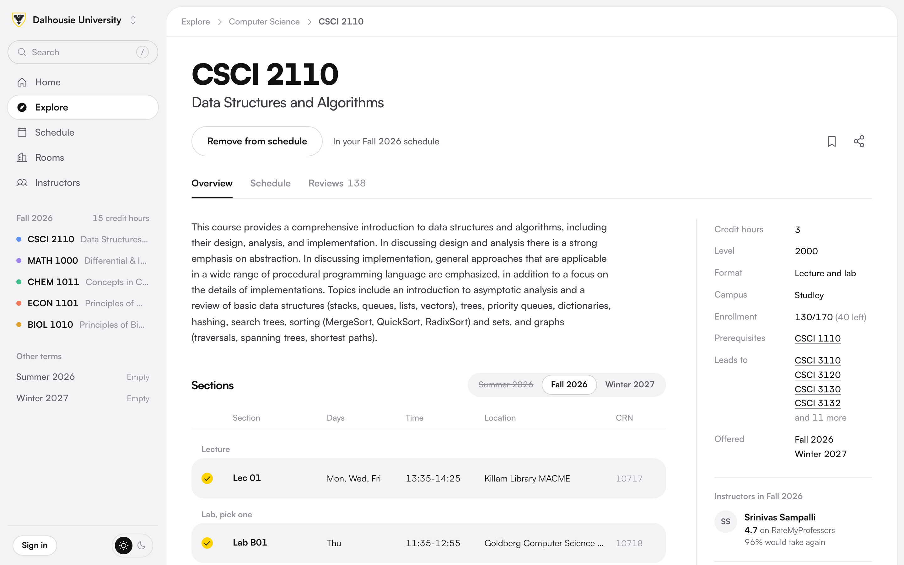
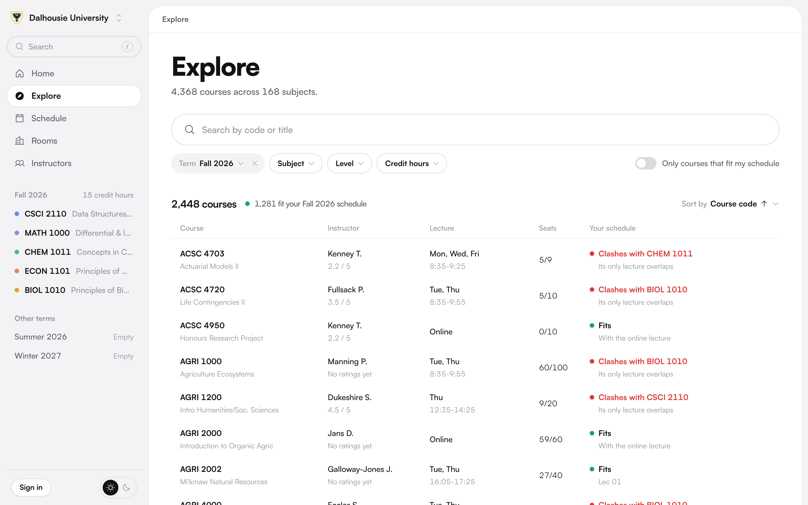

# Termly

[termly.ca](https://termly.ca), formerly DalSearch.

Picking courses usually means flipping between your school's timetable, RateMyProfessors and a half-drawn week in your notes to see what overlaps. Termly puts it on one page. Search any course, see its sections, open seats, prerequisites and how its instructors are rated, and add what you want to your week. It tells you what fits and what clashes before you register, then copies your CRNs so registering takes a minute.

## Universities

Dalhousie, Kwantlen Polytechnic, Laurentian, Memorial, Mount Saint Vincent, Saint Mary's, St. Francis Xavier, Thompson Rivers, Northern British Columbia, Prince Edward Island, Saskatchewan, Victoria and Yukon. Each one's pages live at its own address (`termly.ca/dal`, `termly.ca/smu`) in its own colours.

Timetables are refreshed every morning from each school's own registration system; course descriptions and RateMyProfessors ratings are refreshed weekly. Reviews on Termly come only from a school's own students: you sign up with your school email, and students cross-registered somewhere else confirm that school's email before reviewing its courses.

## Running it locally

Course data lives in Supabase, so you need a project to point at, either your own or a local one with `supabase start`.

1. Run the migrations in `supabase/migrations`.
2. Put `NEXT_PUBLIC_SUPABASE_URL`, `NEXT_PUBLIC_SUPABASE_PUBLISHABLE_OR_ANON_KEY` and `SUPABASE_SECRET_KEY` in `.env.local`.
3. Load a university's timetable: `npm ci --prefix src/scripts/node && node src/scripts/node/refresh.js dal --details none`. That takes a few minutes; drop `--details none` to also fetch every course description.
4. `npm run dev` and open `localhost:3000/dal`.

## Adding a university

Each university has a scraper in `src/scripts/node/universities/<id>.js`, and they all return the shape described in `src/scripts/node/lib/import.js`. Schools on Ellucian Banner 9 or Colleague Self-Service mostly need a config for the shared adapters in `src/scripts/node/lib/`. Add the school to `src/lib/university.ts` (name, colour, logo, timezone) and a row to the `universities` table, and the daily GitHub workflow picks up the new scraper on its own.

Not affiliated with any of these universities. Made by Théo Bourgeois and Chris Langille.
