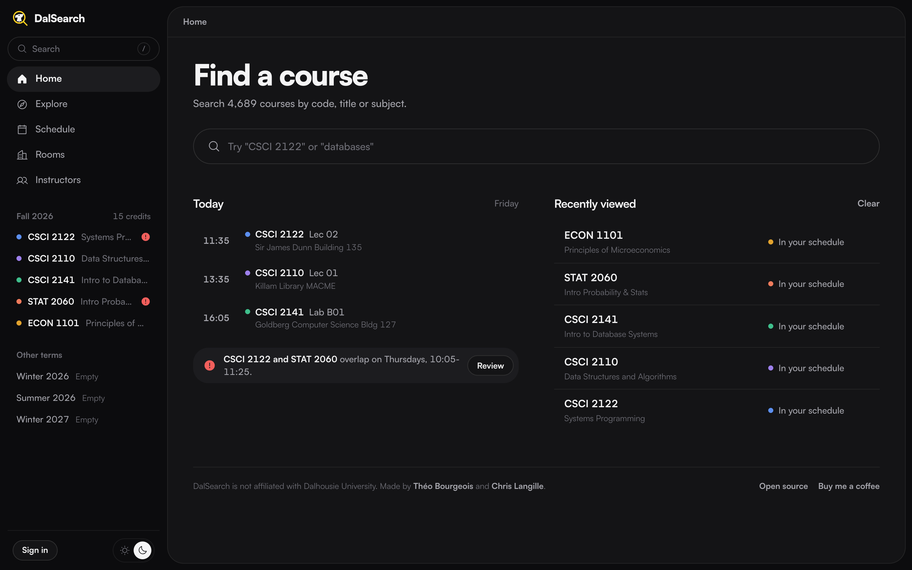

# DalSearch

[dalsearch.com](https://dalsearch.com)

Picking courses at Dal usually means flipping between the timetable, RateMyProfessors and a half-drawn week in your notes to see what overlaps. DalSearch puts it all in one place. Search any Dal course, see its sections, prerequisites and how its instructors are rated, and add what you want to your week. It tells you what fits and what clashes before you register, then copies your CRNs so registering takes a minute.

Not affiliated with Dalhousie University. Made by Théo Bourgeois and Chris Langille.
