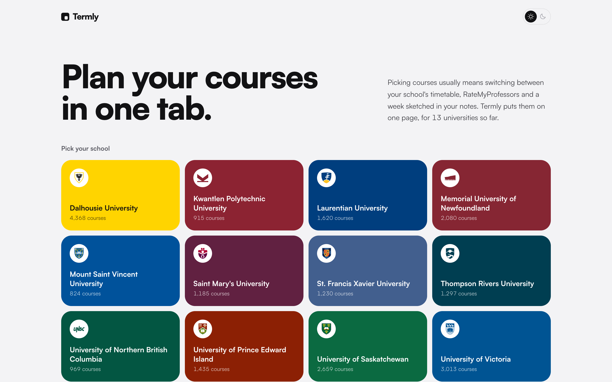
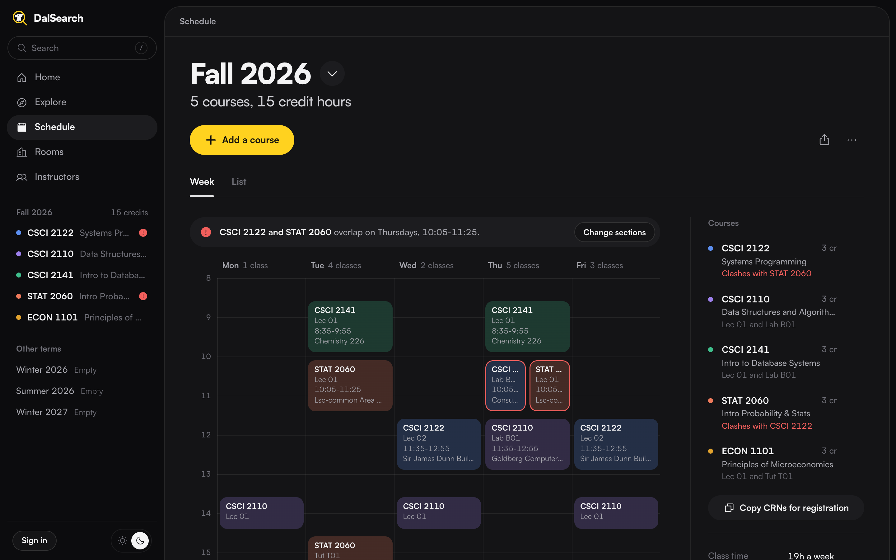
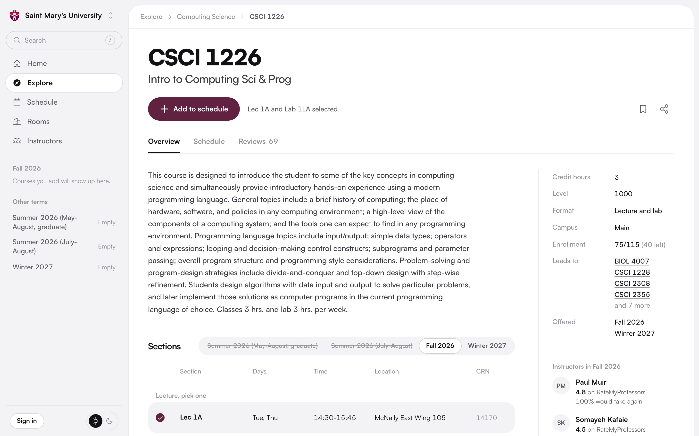
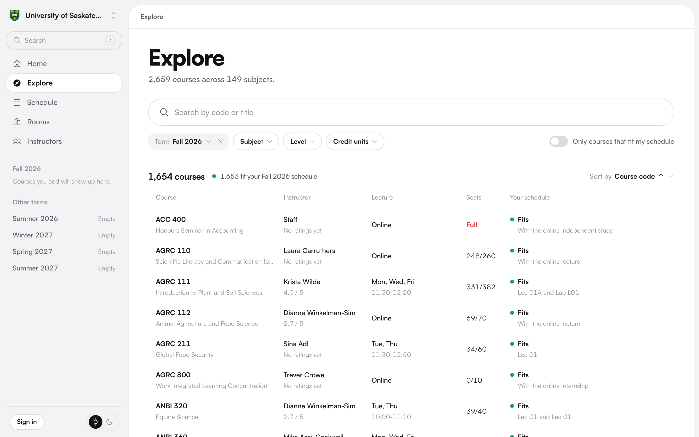
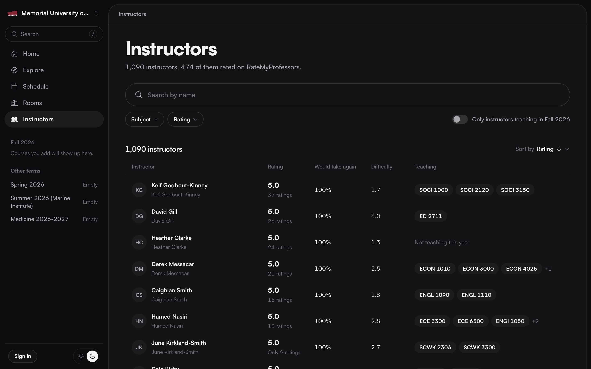

# Termly

[termly.ca](https://termly.ca)

Picking courses usually means flipping between your school's timetable, RateMyProfessors and a half-drawn week in your notes to see what overlaps. Termly puts it on one page. Search any course at your university, see its sections, open seats, prerequisites and how its instructors are rated, and add what you want to your week. It tells you what fits and what clashes before you register.

Not affiliated with any of these universities. Made by Théo Bourgeois and Chris Langille.
